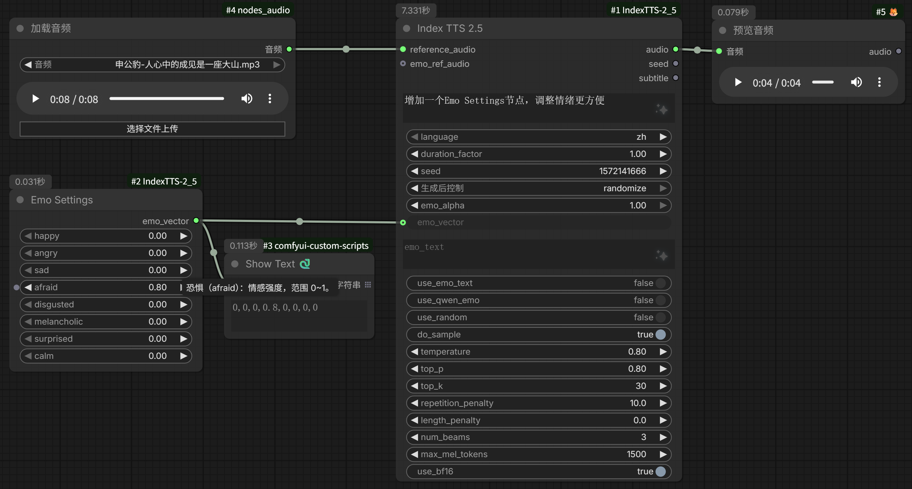

# ComfyUI-IndexTTS-2_5

IndexTTS-2.5 的 ComfyUI 自定义节点。零样本文本转语音，支持中文 / 英文 / 日语 /
西班牙语 / 阿拉伯语，具备情感控制与语速控制。

## 节点

- **Index TTS 2.5**（`IndexTTS2_5Node`）
  - 必填：`text`、`reference_audio`（AUDIO）、`language`、`duration_factor`、`seed`
  - 可选情感控制：`emo_ref_audio` / `emo_vector`（8 维）/ `emo_text`（需 QwenEmotion）
  - 采样参数：`do_sample` / `temperature` / `top_p` / `top_k` / `repetition_penalty` 等
  - 输出：`audio`（AUDIO）、`seed`、`subtitle`
- **Emo Settings**（`EmoSettingsNode`）
  - 8 个情感滑块：`happy` / `angry` / `sad` / `afraid` / `disgusted` / `melancholic` / `surprised` / `calm`，范围 0~1
  - 输出：`emo_vector`（STRING，逗号分隔的 8 维向量）
  - 连线到 `Index TTS 2.5` 的 `emo_vector` 输入即可，无需手写向量字符串

### 工作流预览



参考音频：

<audio controls src="example/ref_audio.mp3"></audio>

生成结果：

<audio controls src="example/result.wav"></audio>

## 使用说明

### 情感控制

节点提供三种情感控制方式：情感参考音频 `emo_ref_audio`、情感向量 `emo_vector`、
情感文本 `emo_text`。三者互斥——提供 `emo_vector` 或 `emo_text` 时，`emo_ref_audio`
会被忽略。

#### emo_vector（情感向量）

8 个数字，顺序固定：

```
高兴 / 愤怒 / 悲伤 / 恐惧 / 反感 / 低落 / 惊讶 / 自然
```

支持逗号分隔或 JSON 数组两种写法：

- `0.8,0,0,0,0,0,0,0`
- `[0.8,0,0,0,0,0,0,0]`

规则：

- 必须**恰好 8 个**数字，否则被忽略（不生效）。
- 数值建议 0~1，越大该情绪越强；`0,0,0,0,0,0,0,1` 表示自然 / 平静。
- `emo_alpha`（0~1）会整体缩放向量强度。

示例：

- 高兴：`0.8,0,0,0,0,0,0,0`
- 愤怒：`0,0.9,0,0,0,0,0,0`
- 悲伤：`0,0,0.8,0,0,0,0,0`
- 自然：`0,0,0,0,0,0,0,1`

> 也可用 **Emo Settings** 节点：8 个滑块（0~1）可视化调节情绪，输出即 `emo_vector`，
> 直接连线到 `Index TTS 2.5` 的 `emo_vector` 输入，免去手写字符串。

#### emo_text（情感文本）

用自然语言描述情绪，由 QwenEmotion 模型自动分析为 8 维情感向量（效果等同
`emo_vector`）：

- 支持「高兴」「愤怒」「悲伤」「恐惧」「反感」「低落」「惊讶」「自然」，也支持完整句子。
- **非空即自动启用**：无需单独勾选 `use_emo_text` / `use_qwen_emo`。
- 需要 `qwen0.6bemo4-merge/` 模型（见「模型放置」），否则报错。

> 触发词「低落 / melancholy / depressed / gloomy」等会映射到「低落」，避免被误判为「悲伤」。

## 内存 / 显存管理

IndexTTS-2.5 整套模型（GPT 3.1 GB + Wav2Vec2-BERT + S2Mel + BigVGAN 等）加载后
常驻 GPU，默认行为是**模型常驻、重复生成快**。若需要把内存/显存腾给 ComfyUI 中的
其它模型（图像 / 视频节点），使用 `auto_free_memory` 开关：

- **`auto_free_memory`（BOOLEAN，默认 `false`）**
  - 勾选后：**每次生成成功**时自动卸载整套模型——清空加载器缓存、显式断开子模型引用、
    `gc.collect()`、`torch.cuda.empty_cache()`（把 PyTorch 缓存分配器预留的显存真正
    归还系统），控制台会打印释放后的 GPU 占用。
  - 代价：下次生成需要重新加载模型（约 10~60 秒，取决于磁盘与设备）。
  - 仅在**生成成功**后释放；推理失败时保留模型缓存以便直接重试。

相关机制（无需操作，自动生效）：

- **进程级共享加载器**：同一工作流中多个 `Index TTS 2.5` 节点复用同一个模型实例，
  不再出现「每个节点一份模型」导致的显存成倍增长；`release()` 也能一次性全部释放。
- **临时文件清理**：参考音频 / 情感参考音频写入的临时 wav 在每次 `generate` 结束
  （无论成功或失败）后自动删除，不再堆积在系统临时目录。

## 模型放置

将 IndexTTS-2.5 权重放到：

```
<ComfyUI>/models/TTS/IndexTTS-2.5/
```

必需文件（官方权重包自带）：

```
config.yaml
gpt.pth
s2mel.pth
codec.pth
wav2vec2bert_stats.pt
feat1.pt
feat2.pt
multilingual_zh_ja_yue_char_del.tiktoken
qwen0.6bemo4-merge/          # 可选，情感文本需要
```

下载方式（HuggingFace）：

```bash
hf download IndexTeam/IndexTTS-2.5 --local-dir="<ComfyUI>/models/TTS/IndexTTS-2.5"
```

或 ModelScope：

```bash
modelscope download --model IndexTeam/IndexTTS-2.5 --local_dir "<ComfyUI>/models/TTS/IndexTTS-2.5"
```

## 辅助模型（首次运行自动下载）

三个辅助模型不会出现在权重包内，首次推理时由上游
`ensure_models_available` 自动下载到 `<模型目录>/hf_cache/`：

- `w2v-bert-2.0`（语义编码器）
- `campplus_cn_common.bin`（说话人嵌入）
- `bigvgan`（声码器）

若 HuggingFace 访问慢，建议提前设置镜像：

```bash
export HF_ENDPOINT="https://hf-mirror.com"
```

## 依赖

本节点 vendored 了官方 `indextts` 包源码（`indextts/` 目录），在 ComfyUI 进程内
直接运行，无需额外安装官方仓库。

关键点：官方 `pyproject.toml` 里的 `keras==2.9.0` 是历史遗留依赖，
**IndexTTS-2.5 推理链路并不 import keras**，因此本节点不要求安装 keras，
也不受官方 `Python<3.12` 的限制（可在 Python 3.12 下运行）。

> **transformers 版本**：本节点 vendored 的 `indextts` 源码是 transformers 4.52 的
> fork，已通过 `compatibility_patch.py` 适配到当前环境的 `transformers 4.57.x`
> （`QuantizedCacheConfig`→`QuantizedCache` 等改名）。若环境里的 transformers 版本
> 不同，可能需要重新调整该补丁。

```bash
pip install -r requirements.txt
```

- 日语 TTS 额外需要 `fugashi` + `unidic-lite`（未装时仅日语会报错）。
- `flash-attn` / CUDA kernel 加速默认关闭（避免 torch2.9+cu130 下 ABI 不匹配），
  需要时可在 `model_loader.py` 中开启。

## 节点开发环境

以下为开发 / 验证本节点时使用的环境（ComfyUI 运行于 conda 环境 `cu130`）：

| 项目 | 值 |
| --- | --- |
| 操作系统 | Windows 11（10.0.26200） |
| Python | 3.12.12 |
| PyTorch | 2.9.1+cu130 |
| CUDA（torch 运行时） | 13.0 |
| 显卡驱动 | 610.88（CUDA 13.3） |
| cuDNN | 9.12.0 |
| GPU | NVIDIA GeForce RTX 5090（32 GB） |
| transformers | 4.57.6 |

> `transformers` 版本与本节点的 `compatibility_patch.py` 绑定，升级后若报错需同步调整
> 该补丁（见上文「依赖」一节）。
